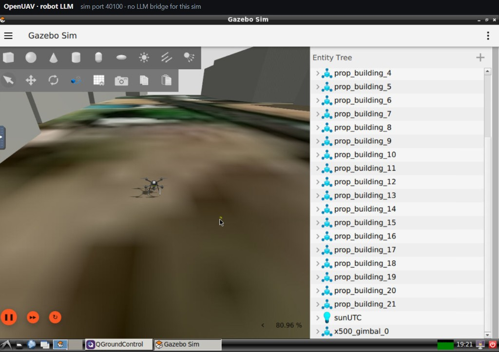
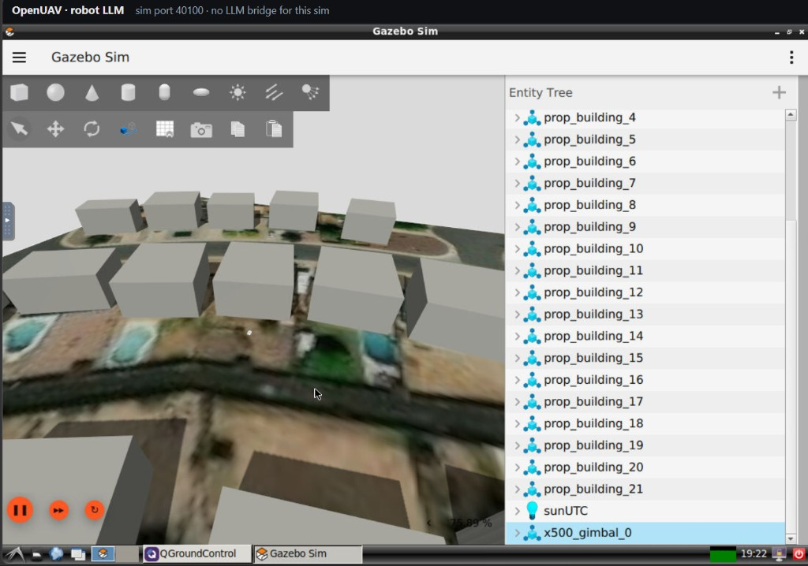
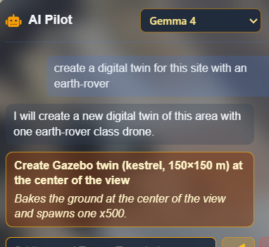

# twin_builder

Dreamslab worker that turns a Cesium look-at into a Gazebo session twin.

A superuser confirm in the DeepGIS AI Pilot posts the crosshair, the patch size,
and a viewport photo. This process bakes the site and starts
`digital-twin-session-<callsign>` from `digital-twin-locutus:llm`. The world PX4
and QGroundControl load is that image's `default.sdf`, with the viewport
lat/lon/elev written over the image's home and the patch spliced in. It does
not join the Locutus or aquatic twins.

## What a confirm produces

The ground is a north-up satellite image of the patch, sized to the requested
metres and sitting at the origin. OpenStreetMap building footprints in that
patch become static boxes (height from the `height` tag or `building:levels`,
otherwise 8 m). Trees, cars, fences, and water can still come from the nadir
photo. The vehicle spawned today is one kestrel-class `x500_gimbal`.

The close view is the drone on that satellite ground. The wider view shows the
same ground with the building boxes. The entity tree lists `prop_building_*`
and `x500_gimbal_0`.





The desktop is the session noVNC port in the 40100–40199 band. This session
has no robot-LLM bridge. Lab desktops stay on 40077, 40088, and 40099.

## Earth rover

Asking for an earth rover does not spawn one. The pilot schema only allows
`vehicle_class=kestrel`, and the session image has no `earth_rover` model and
no airframe 4024. The confirm card still offers one x500. The earth rover that
already drives in Locutus (callsign badger) is a different machine from this
new session.



## Flow

1. **capture** — DEM grid to a 16-bit heightmap. The heightmap is best-effort
   and is not the file Gazebo loads.
2. **osm_buildings** — building ways in the patch, as boxes. These replace
   vision-model buildings.
3. **vlm_props** — nadir photo to a JSON scene graph for the other classes.
4. **satellite_ground** — one satellite export of the patch, mounted on the
   ground plane.
5. **spawn** — desktop, QGroundControl, MicroXRCEAgent, and
   `gz_x500_gimbal`. `host_port` comes from the DeepGIS simulation registry.
6. **enroll** — pose-agent env. Chase from the page still needs that callsign
   in the live pose stream.

## Run (dreamslab)

```bash
export DEEPGIS_TWIN_BUILDER_TOKEN=...   # shared with deepgis-xr
export DEEPGIS_TWIN_JOBS_DIR=/var/twin-jobs
export DEEPGIS_TWIN_SESSIONS_DIR=/var/twin-sessions
export DEEPGIS_TWIN_SPAWN_DRY_RUN=1     # write the world and stop before docker
python -m twin_builder
```

DeepGIS posts to `DEEPGIS_TWIN_BUILDER_URL` with the same bearer token. When
either is unset, deepgis-xr runs an in-process stub and does not start a
container.

## Safety

- Auth required on every request
- Protected names refused (locutus, otter, aquatic, and the other lab twins)
- One active job per user (enforced in deepgis-xr)
- Idle TTL and a disk quota on session dirs
- Scene output is JSON to an SDF writer only (no shell)
