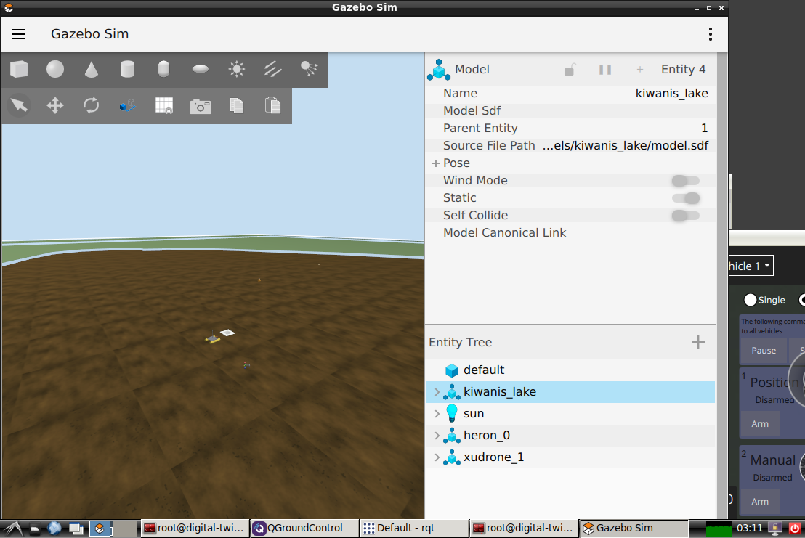
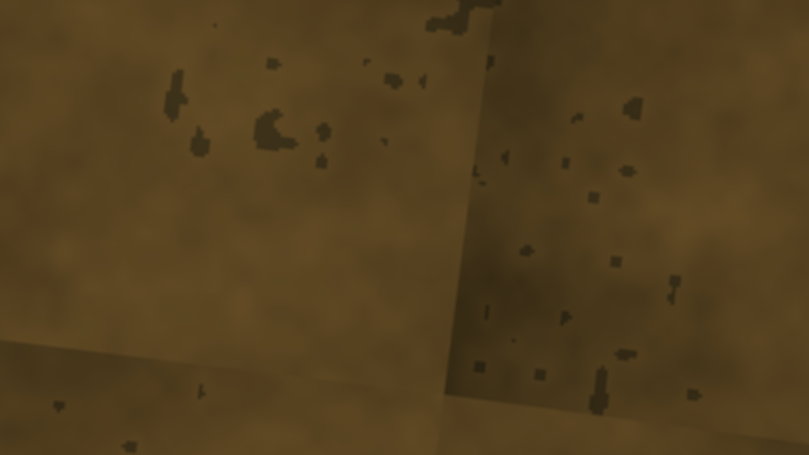
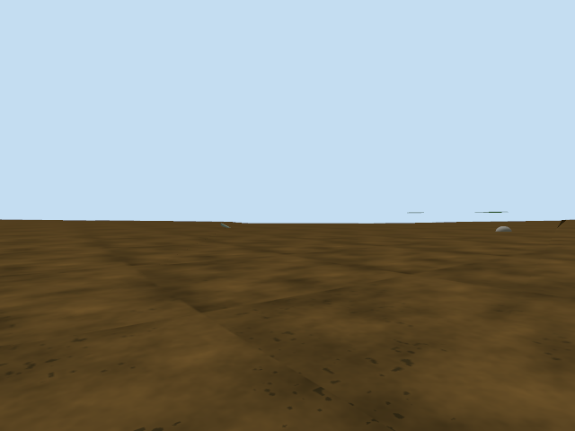
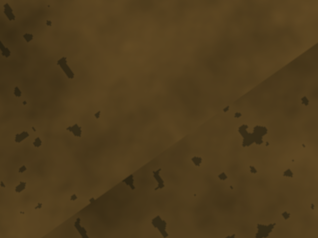

# udrone — CoRAL aquatic twin (otter_k + xudrone)

Kiwanis Lake sandbox in **`digital-twin-aquatic`** (host panel **:40077**).
Isolated from the production otter (`digital-twin-water-tempe-lake`, **:40099**)
by `ROS_DOMAIN_ID=84` and `GZ_PARTITION=aquatic`.

Two-robot mode follows the Locutus pattern (kestrel instance 0 + badger instance 1)
and the [CoRAL](https://github.com/Earth-Innovation-Hub/CoRAL) boat + docked AUV idea:
surface ASV carries an 8″ AUV, undocks for volume search / tag approach, and can
re-latch under the catamaran. DeepGIS + dreams_llm drive the pair through
`coral_bridge` (`instruction` → typed `/coral` behaviours).

| vehicle | callsign | PX4 | Gazebo model | DDS namespace | role |
|---|---|---|---|---|---|
| Clearpath Heron ASV | **otter_k** | instance 0, airframe **4023** (`gz_heron`) | `heron_0` | `/otter_k/fmu/...` | surface boat |
| uDrone AUV | **xudrone** | instance 1, airframe **60003** | `xudrone_1` | `/xudrone/fmu/...` | docked under the catamaran |

Callsign is **`otter_k`** (underscore). A ROS 2 name cannot contain a hyphen, so
`otter-k` topics exist on DDS but no ROS node can subscribe or remap them.

Solo AUV mode is also supported: only instance 0, model `xudrone_0`, same airframe
60003 — see [Start / stop](#start--stop).

## Gazebo world (screenshots)

Kiwanis Lake bed + shoreline in Gazebo Sim; entities `heron_0` (yellow ASV) and
`xudrone_1` (AUV). A white **0.50 m cube** at ~ENU (5 E, 4 N, centre z≈−1.83)
carries **AprilTag 36h11 id 0** (0.40 m) on **all six faces** so front, nadir, and
side views can lock for survey stop and `approach_tag`. **AprilTag 36h11 id 10**
(0.40 m) is centered on the underside of the Heron deck, facing down, for the
upward camera. A **1 m vertical orange
ring** (tube radius 0.045 m, 12 segments) sits at ENU (6, 0, −1), opening along
east-west. It has no AprilTags; `hoop` finds it with the front camera.



| otter_k nadir | xudrone front | xudrone nadir |
|---|---|---|
|  |  |  |

## Layout

| path | installs to | notes |
|---|---|---|
| `model/xudrone/` | `…/gz/models/xudrone/` | 8″ WTE + 4× T200 |
| `model/heron/` | `…/gz/models/heron/` | aquatic copy (same physics as `otter/`) |
| `world/kiwanis_lake.sdf` + `world/kiwanis_lake/` | worlds + model | shoreline, bed, pier — [docs/KIWANIS.md](docs/KIWANIS.md) |
| `airframe/60003_gz_xudrone` | PX4 ROMFS + build-tree | Gazebo SITL AUV (this twin) |
| `airframe/60003_auv_udrone` | *(reference only)* | non-Gazebo / hardware-oriented sibling; not installed by `install.sh` |
| `adapter/udrone_thrust_adapter.cpp` | `/usr/local/bin/udrone_thrust_adapter` | PX4 ESC → Gazebo thrust |
| `plugin/LinkAttacher.*` | `…/gz-sim-8/plugins/` | dock latch |
| `scripts/dock_command.py` | `/usr/local/bin/dock_command.py` | ATTACH / DETACH / STATE |
| `behaviours/` | `/root/udrone_boat/behaviours/` + `/usr/local/bin/coral_*.sh|py` | dock / goto / survey / helix / swim / hoop / track / coverage / approach_tag + tags |
| `xudrone_camera_bridge.sh` | `/usr/local/bin/…` | front camera → `/xudrone/camera_front/*` |
| `*_down_camera_bridge.sh` | `/usr/local/bin/…` | nadir cameras → `/otter_k|xudrone/camera_down/*` |
| `xudrone_up_camera_bridge.sh` | `/usr/local/bin/…` | upward camera → `/xudrone/camera_up/*` (deck tag 10) |
| `xudrone_range_bridge.sh` | `/usr/local/bin/…` | EchoRanger + surface beam → `/xudrone/range/{bottom,surface}` |
| `start_boat.sh` | `/root/start_boat.sh` | CoRAL pair (default `simctl start`) |
| `start_udrone.sh` | `/root/start_udrone.sh` | `--secondary` (from boat) or solo |
| `stop_sim.sh` | `/root/stop_sim.sh` | used by `simctl stop` |
| `patch_simctl_coral.sh` | patches `/usr/local/bin/simctl` | status lines for the pair |
| `test/` | `/root/udrone_boat/src/` | demos and checks |

Heron airframe **4023** and `heron_thrust_adapter` come from the base aquatic image
(same lineage as [`../otter`](../otter)); this pack does not reinstall them.

## Install

On dreamslab, with the aquatic simulator **stopped** (or every vehicle disarmed —
`install.sh` will stop it for you):

```bash
git clone https://github.com/Earth-Innovation-Hub/digital-twins.git   # or pull
cd digital-twins/udrone
C=digital-twin-aquatic bash install.sh
```

Builds the thrust adapter and latch plugin, refuses if a vehicle is armed, stops
the sim, installs models/world/airframe/scripts, patches `simctl`, and leaves the
sim stopped. Does **not** touch `:40099`.

```bash
docker exec digital-twin-aquatic simctl start
```

## Start / stop

All commands below are on dreamslab. Prefer `simctl` / `twinctl` over calling the
scripts by hand.

| action | command |
|---|---|
| Start CoRAL pair | `docker exec digital-twin-aquatic simctl start` |
| Status | `docker exec digital-twin-aquatic simctl status` |
| Stop (leave desktop + DeepGIS agents) | `docker exec digital-twin-aquatic simctl stop` |
| Restart | `docker exec digital-twin-aquatic simctl restart` |
| Host wrapper | `~/bin/twinctl aquatic status\|start\|stop\|restart` |

What `simctl start` runs: `vglrun /root/start_boat.sh` → PX4 instance 0
(`otter_k` / Heron) + forks `/root/start_udrone.sh --secondary` (instance 1,
`xudrone_1` spawned at the boat). The world plugin seats the AUV at nest pose
`0 0 0` (boat frame) and welds it.

**Solo AUV** (no boat — for helix demos without the latch):

```bash
docker exec digital-twin-aquatic simctl stop
docker exec -d -e DISPLAY=:1 -e VGL_DISPLAY=:0.0 digital-twin-aquatic \
  bash -c 'cd /root && exec vglrun ./start_udrone.sh >> /root/log/start_udrone.out 2>&1'
# stop again with simctl stop when finished
```

**noVNC:** host panel **:40077**. QGC inside the desktop can talk to both SITL
instances; stay off it while automated tests run.

## Dock latch

gz-sim8 world plugin (Open-UAV
[`gazebo_ros_link_attacher`](https://github.com/Open-UAV/gazebo_ros_link_attacher)
semantics): fixed `DetachableJoint` between `heron_0::base_link` and
`xudrone_1::base_link`. Nest pose is boat-frame `0 0 0` (between the hulls,
under the deck). On ATTACH the AUV is teleported to the nest, then welded.

| command | how |
|---|---|
| ATTACH | `docker exec digital-twin-aquatic dock_command.py ATTACH` |
| DETACH | `docker exec digital-twin-aquatic dock_command.py DETACH` |
| state | `dock_command.py STATE` → `attached` / `detached` |

Topics: `/udrone_dock/command` (`gz.msgs.StringMsg`),
`/model/heron_0/udrone_dock/{attach,detach}` (`Empty`),
`/model/heron_0/udrone_dock/state`.

Gates on re-attach: **≤ 0.6 m** from the nest and **≤ 30°** relative yaw.
`auto_attach_on_start` welds once after spawn. Exit status of ATTACH/DETACH is 1
if the latch did not reach the requested state (e.g. out of range).

## Behaviour library (`/coral`)

Twin-side executor for typed commands. Started automatically ~25 s after
`simctl start` (log `/root/log/coral_behaviours.log`). The LLM lives on
tesseract (`coral_bridge` + `coral_instructions`); this node only runs behaviours
and emits events.

| topic | direction | payload |
|---|---|---|
| `/coral/command` | in | JSON `std_msgs/String` |
| `/coral/event` | out | accepted / arrived / dock_done / helix_done / swim_done / hoop_done / track_done / coverage_done / approach_done / survey_done / failed / rejected / aborted |
| `/coral/status` | out | ~1 Hz: busy, phase, latch, boat/auv pose |
| `/coral/detections` | out | settled AprilTag ENU records |
| `/coral/tracks` | out | ~2 Hz live ENU while a tag is in view (coverage / logging) |

Commands:

```json
{"type":"dock","action":"attach"|"detach","id"?}
{"type":"goto","along_heading_m":8,"id"?}
{"type":"goto","east_m":..,"north_m":..,"relative_to":"current"|"world"|"heading","id"?}
{"type":"survey","width_m":20,"length_m":20,"until"?: "tag_detected","id"?}
{"type":"helix","duration_s"?, "radius_m"?, "omega"?, "vx"?, "z0"?, "id"?}
{"type":"swim","north_m"?, "east_m"?, "along_heading_m"?, "relative_to":"current"|"world"|"heading", "depth_m"?, "speed_mps"?, "arrive_m"?, "id"?}
{"type":"hoop","id"?}
{"type":"track","duration_s"?, "standoff_m"?, "id"?}
{"type":"coverage","width_m"?, "length_m"?, "swath_m"?, "layers"?, "z_top"?, "z_bottom"?, "speed_mps"?, "center_east_m"?, "center_north_m"?, "until"?: "tag_detected","id"?}
{"type":"approach_tag","tag_id"?, "standoff_m"?, "tag_size_m"?, "settle_s"?, "timeout_s"?, "acquire_s"?, "search_budget_s"?, "search_r0_m"?, "search_r_max_m"?, "center_east_m"?, "center_north_m"?, "id"?}
{"type":"hold"|"abort","id"?}
```

| behaviour | vehicle | notes |
|---|---|---|
| `goto` / `survey` | otter_k | surface leg / 2D lawnmower; `until: tag_detected` stops early |
| `helix` | xudrone | forward helix (force → point-hull-axis) |
| `swim` | xudrone | one straight leg on that same force loop. `depth_m` is metres below the surface; omit it to keep the depth at arm. Rejected while latched |
| `hoop` | xudrone | front-camera search for the orange ring, then one smooth join onto the centerline through the opening. A pass needs the ring around the optical axis and the hull inside the opening at ENU (6, 0, −1). Rejected while latched. Debug image: `/xudrone/hoop_debug/image` |
| `track` | xudrone | hold about 1 m under otter_k. The upward camera watches deck tag 10; the boat pose predicts the station and the tag corrects it. Phrase `xudrone: track otter_k`. Rejected while latched |
| `coverage` | xudrone | 3D boustrophedon (same controller, new `pos_des`); optional `until: tag_detected` |
| `approach_tag` | xudrone | Expanding spiral search → front-cam IBVS rates + thrust (`VehicleRatesSetpoint` / `UUV_SKIP_CTRL`); EchoRanger/surface clearance; settle → `approach_done` |
| `dock` | latch | boat-nest ATTACH/DETACH (gates 0.6 m / 30°) — not bed-tag geometry |

Default `tag_size_m` is **0.4** (matches the cube faces / `apriltag.yaml`).

Perception: otter_k nadir → `/otter_k/detections`; xudrone **front** →
`/xudrone/detections` (primary until-stop while pitched); xudrone nadir →
`/xudrone/detections_down` + `tag_detector` ENU / tracks; xudrone **upward** →
`/xudrone/detections_up` (tag 10 under the deck).

`track` is the Kiwanis form of Harish Anand's thesis,
[Coordinated Navigation and Localization of an Autonomous Underwater Vehicle Using an Autonomous Surface Vehicle in the OpenUAV Simulation Framework](https://keep.lib.asu.edu/_flysystem/fedora/c7/233928/Anand_asu_0010N_20290.pdf)
(MS, Arizona State University, August 2020, PDF). The thesis holds the AUV 5 m under a marker on the ASV. Kiwanis Lake is about 2.4 m deep, so the station is 1 m under tag 10.

**Range / depth (state estimation + awareness):** downward EchoRanger
(`lidar_sensor_link`) feeds PX4 `distance_sensor` via GZBridge with
`EKF2_RNG_CTRL=1` (baro remains `EKF2_HGT_REF`); GZ `air_pressure_sensor` → baro.
ROS bridge publishes `/xudrone/range/bottom` and `/xudrone/range/surface` for
`approach_tag` bed/surface clamps.

CLI (inside the container; waits for the terminal event):

```bash
docker exec digital-twin-aquatic coral_cmd.py status
docker exec digital-twin-aquatic coral_cmd.py dock detach
docker exec digital-twin-aquatic coral_cmd.py goto --along 8
docker exec digital-twin-aquatic coral_cmd.py helix --duration 20 --radius 0.4
docker exec digital-twin-aquatic coral_cmd.py swim --north 10
docker exec digital-twin-aquatic coral_cmd.py hoop
docker exec digital-twin-aquatic coral_cmd.py track --duration 90 --standoff 1
docker exec digital-twin-aquatic coral_cmd.py coverage --width 12 --length 12 --layers 3
docker exec digital-twin-aquatic coral_cmd.py approach_tag --standoff 1.5 --east 5 --north 4 --world
docker exec digital-twin-aquatic coral_cmd.py dock attach
```

Example LLM-facing plan: *undock → short coverage until tag → approach the tag*
→ `dock detach`, `coverage(until=tag_detected)`, `approach_tag`. One command at a
time (`busy` rejects overlaps); `abort` cancels.

## Demos and tests

Entry point (inside the container; sources ROS and sets domain / partition):

```bash
docker exec digital-twin-aquatic /root/udrone_boat/src/run_test.sh <name>
```

| name | script | what it checks | typical wall time |
|---|---|---|---|
| **`latch`** | `latch_test.py` | docked at nest; DETACH; ATTACH refused far / misaligned; ATTACH accepted in range; Empty topics | ~30 s |
| **`transit`** | `boat_transit_test.py` | otter_k arms, drives ~8 m with xudrone latched; jets on; AUV rigid in boat frame | ~15 s |
| **`undock`** | `udrone_undock_helix_test.py` | 10 s helix while docked → DETACH → 10 s free; thrusters, rigid docked, release, dive, helix track | ~35 s |
| **`helix`** | `udrone_sinusoidal_controller.py` | free AUV tracks a forward helix (mean 3D error &lt; 0.25 m after settle) | ~65 s |
| **`redock`** | `redock.py` | teleport AUV under the boat and ATTACH (sim shortcut between runs) | ~5 s |

Suggested order after `simctl start`:

```bash
docker exec digital-twin-aquatic /root/udrone_boat/src/run_test.sh latch
docker exec digital-twin-aquatic /root/udrone_boat/src/run_test.sh transit
docker exec digital-twin-aquatic /root/udrone_boat/src/run_test.sh undock
docker exec digital-twin-aquatic /root/udrone_boat/src/run_test.sh redock   # optional
# free helix with the pair still up (AUV already free after undock):
docker exec digital-twin-aquatic /root/udrone_boat/src/run_test.sh helix
```

Solo helix: stop the pair, start `start_udrone.sh`, then `run_test.sh helix`
(auto-detects `xudrone_0` / instance 0).

### Environment knobs

| variable | default | used by |
|---|---|---|
| `UDRONE_HELIX_DUR` | 45 | helix duration (sim s) |
| `UDRONE_HELIX_R` | 0.5 (helix) / 0.4 (undock) | helix radius (m) |
| `UDRONE_HELIX_OMEGA` | 0.40 | rad/s |
| `UDRONE_HELIX_VX` | 0.20 | forward speed (m/s) |
| `UDRONE_HELIX_Z0` | −1.2 / −1.0 | helix centre depth (m) |
| `UDRONE_UNDOCK_AT` | 10 | docked thrust before DETACH |
| `UDRONE_POST_UNDOCK` | 10 | free thrust after DETACH |
| `BOAT_LEG_M` | 8 | transit leg length |
| `BOAT_ARRIVE_M` | 2.0 | arrival radius |
| `UDRONE_GZ_MODEL` / `UDRONE_PX4_INSTANCE` | auto | override target AUV |
| `UDRONE_APPROACH_TAG_SIZE` | 0.4 | IBVS / apriltag physical size (m) |
| `UDRONE_IBVS_AGL_MIN` / `SURF_MIN` | 0.45 / 0.35 | approach bed / free-surface clearance (m) |

Pass env through `docker exec`:

```bash
docker exec -e UDRONE_HELIX_DUR=30 -e UDRONE_HELIX_R=0.6 \
  digital-twin-aquatic /root/udrone_boat/src/run_test.sh helix
```

Logs: `/tmp/udrone_helix_ctrl_log.txt`, `/tmp/udrone_undock_helix_log.txt`.
Exit status **0 = PASS**, **1 = FAIL** (printed `CHECKS` / `VERDICT`).

### Helix controller (design)

xudrone’s four thrusters all push along the hull (+X). There is **no roll
authority** (ballast keeps it upright); pitch and yaw come from differential
thrust. The controller therefore:

1. Asks for a world-frame force (track the helix velocity, cancel drag, cancel
   ~2 N of net buoyancy).
2. Points the hull axis along that force with pitch / yaw torque.
3. Sets surge thrust to the force component along the hull.

While the latch is **attached**, only surge is commanded (the hull cannot turn
inside the boat). Pose feedback is Gazebo `/world/kiwanis_lake/dynamic_pose/info`
(~56 Hz); offboard setpoints use **timestamp 0** so ROS wall time need not match
PX4 sim time. `UUV_SKIP_CTRL 1` feeds `vehicle_rates_setpoint` straight through
to the mixer.

## Thrust chain (AUV)

```
PX4 SIM_GZ_EC  →  /xudrone_1/command/motor_speed     (no /model prefix)
adapter        →  /model/xudrone_1/joint/rotor_N_joint/cmd_thrust
Thruster plugin → body force
```

`/model/<name>/command/motor_speed` is PX4’s **wheel** interface and stays silent
for airframe 60003 — the adapter must not subscribe there.

## Design notes

- Hull: Blue Robotics **8″ WTE** — acrylic tube ID 203.2 mm, L 298 mm, R≈0.111 m.
- Thrusters: 4× **T200 R2**, coplanar stern square, thrust along +X; adapter maps
  PWM-ish 1100–1900 (and ±1) to ±36 N.
- Mass **13.5 kg**; displacement ~13.70 kg → awash at z≈−0.11 without thrust.
- Boat: Heron graded buoyancy + jets (same as production otter); DDS NS `otter_k`.
- Front camera → `/xudrone/camera_front/*`, nadir → `/xudrone/camera_down/*`, upward → `/xudrone/camera_up/*` (one bridge each; flock-guarded). The upward link is pitched −90° on the hull crown so it looks at deck tag 10.
- `SDLOG_MODE` default 0 on airframe 60003 (no .ulg from boot). Set the same on
  otter_k once if its rootfs still has 1: `px4-param --instance 0 set SDLOG_MODE 0`.
- DeepGIS: callsigns **otter_k** and **xudrone** (host watchdogs + pose tokens
  live in the private infra repo).

## Airframes in this folder

| file | SYS_AUTOSTART | when used |
|---|---|---|
| `60003_gz_xudrone` | 60003 | **This twin.** Gazebo SITL, `SIM_GZ_*`, `UUV_SKIP_CTRL`, `UXRCE_DDS_SYNCT 0`, `SDLOG_MODE 0`. |
| `60003_auv_udrone` | 60003 | Reference / non-Gazebo sibling (same mixer geometry). Not copied by `install.sh`. |

Boat airframe **4023** (`gz_heron`) stays in the image / [`../otter`](../otter).
